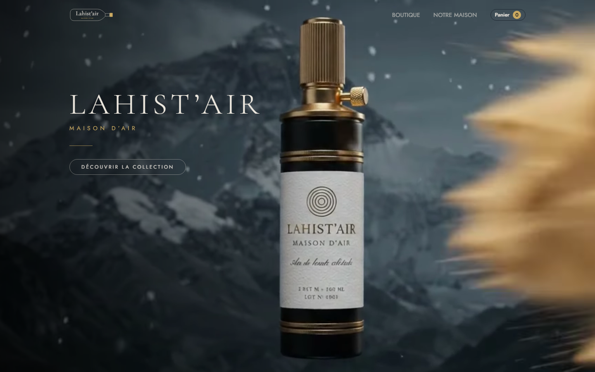
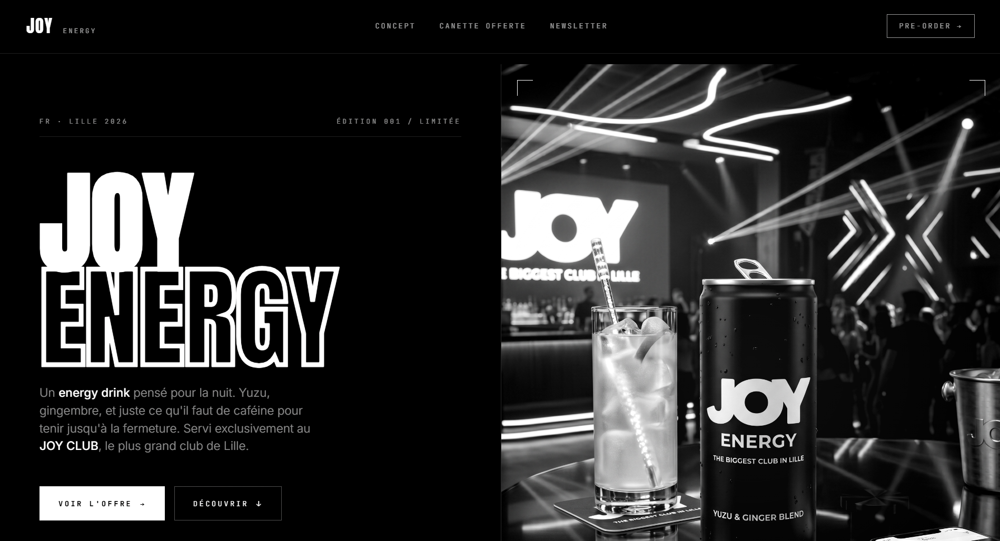
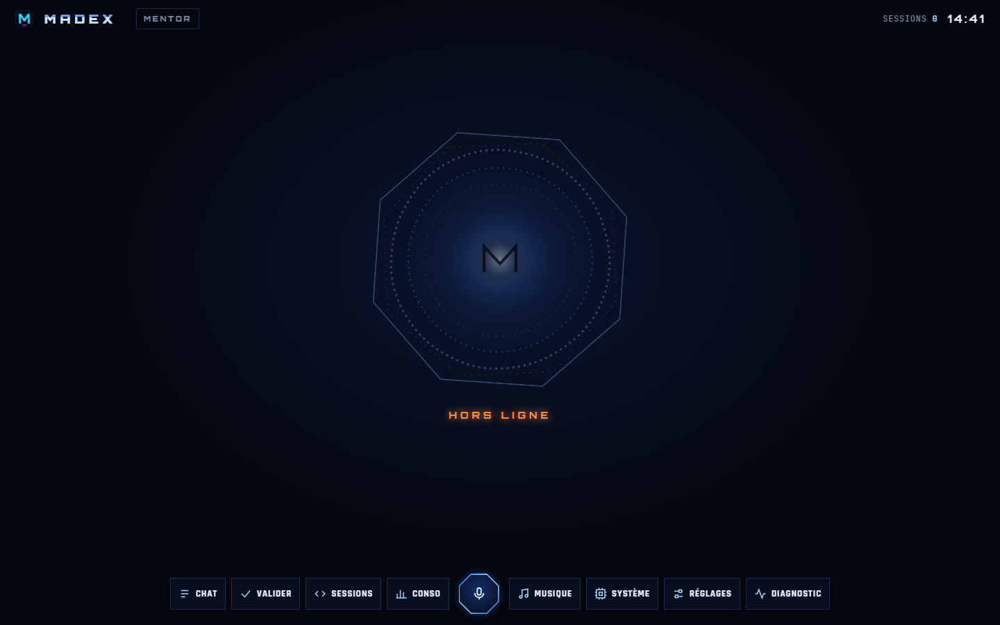

<!-- ===== HEADER ===== -->

  

  

  

  
  
  

---

##  À propos

Développeur **web et mobile** en alternance, je conçois des applications de bout en bout : de l'interface jusqu'à l'API et la base de données.
J'ai découvert le code en cherchant à comprendre comment les jeux vidéo étaient construits. Depuis, je n'ai pas arrêté : sites, apps mobiles, outils d'IA, jeux navigateur.
Ce qui me motive : livrer des produits **rapides**, **soignés** et **agréables à utiliser**, avec un code propre derrière.

 **Parcours** : Licence MIASHS → L2 Informatique → École de développement web en alternance 
 **Alternant** chez **ADEO** 
 **En ce moment** : Vue.js, Kotlin, JavaScript / React et Flutter 
 **Objectif** : devenir un développeur polyvalent qui conçoit des projets utiles, clairs et élégants

---

##  Stack

  

  

---

##  Projets à la une

<table>
  <tr>
    <td width="50%" valign="top">
      
      <h3> Lahist'air</h3>
      
E-commerce haut de gamme pour une maison d'air d'exception : boutique, panier, checkout et certificats. Workshop dev.

      

        
        
        
        
      

       <a href="https://lahistair.vercel.app/">Démo</a> &nbsp;  <a href="https://github.com/madou752/workshop_dev">Code</a>
    </td>
    <td width="50%" valign="top">
      
      <h3> Joy Energy</h3>
      
Landing page d'une boisson énergisante servie au JOY CLUB de Lille : design noir et blanc, typographie XXL, pré-commande. Projet de groupe.

      

        
        
        
      

       <a href="https://joy-club.vercel.app/">Démo</a> &nbsp;  <a href="https://github.com/celest6667/JoyClub">Code</a>
    </td>
  </tr>
  <tr>
    <td width="50%" valign="top">
      
      <h3> DoumsDeal</h3>
      
Marketplace de petites annonces façon LeBonCoin : annonces, catégories, comptes utilisateurs.

      

        
        
      

       <a href="https://github.com/madou752/doumsdeal">Code</a>
    </td>
    <td width="50%" valign="top">
      
      <h3> MADEX</h3>
      
Mon « Jarvis » perso : assistant vocal qui pilote des sessions Claude Code, Spotify et Gmail, avec garde-fous avant chaque action.

      

        
        
        
      

       <a href="https://github.com/madou752/madex">Code</a>
    </td>
  </tr>
</table>

  <a href="https://portfoliohammadoumehdi.vercel.app/"><b>Tous mes projets sur le portfolio</b></a> 

---

##  Activité GitHub

  
  

---

   <i>Envie de collaborer ? On fera de belles choses.</i>

<!-- ===== FOOTER ===== -->

